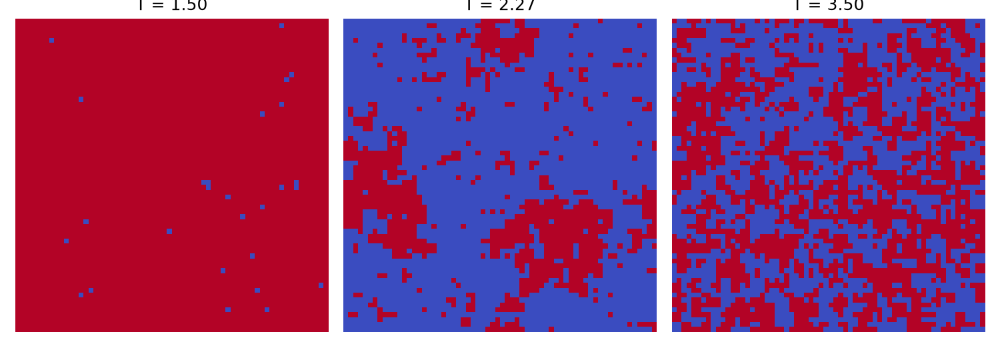
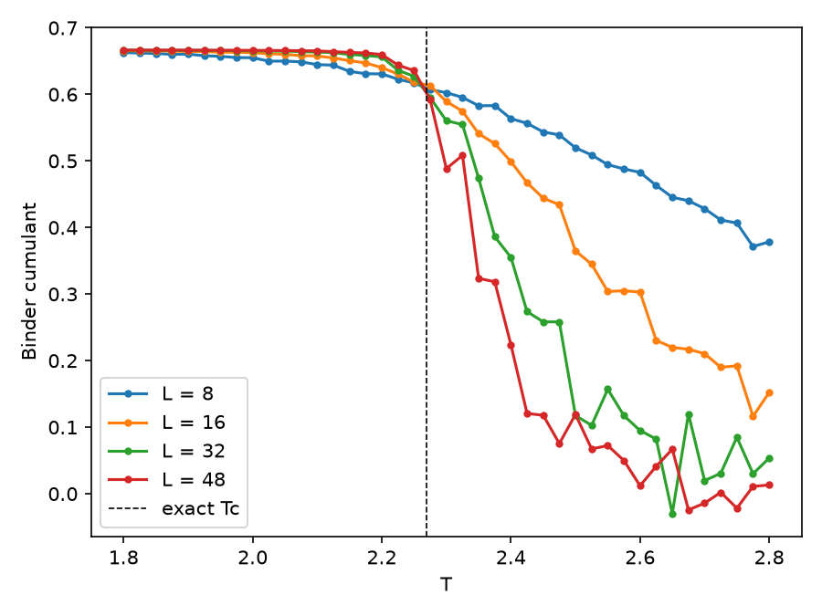
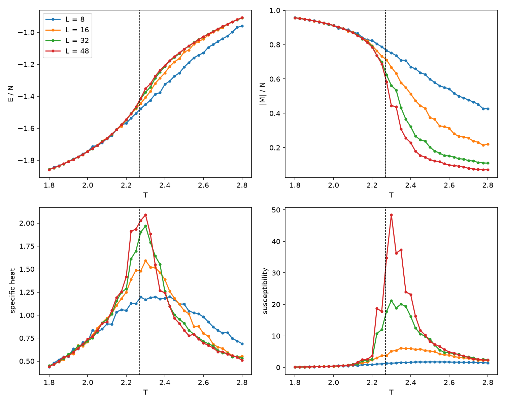

# 2D Ising model: Metropolis Monte Carlo and finite-size scaling

Monte Carlo simulation of the 2D Ising model (square lattice, periodic boundaries,
`J = k_B = 1`) in Python with NumPy. The Metropolis update is vectorised with a
checkerboard split of the lattice, and the critical temperature is estimated with the
**Binder cumulant** and finite-size scaling, then compared with Onsager's exact solution.



## Results

Temperature sweep (41 values between 1.8 and 2.8) for lattices of L = 8, 16, 32 and 48,
with 10 000 measured sweeps and 2 000 equilibration sweeps per point.

| Quantity | Value |
|---|---|
| Exact critical temperature (Onsager) | 2.2692 |
| Binder-cumulant crossing, L = 8 and 16 | 2.283 |
| Binder-cumulant crossing, L = 16 and 32 | 2.258 |
| Binder-cumulant crossing, L = 32 and 48 | 2.268 |
| **Mean of the three crossings** | **2.270** (0.04 % from the exact value) |
| Susceptibility peak, L = 8, 16, 32, 48 | 2.50, 2.35, 2.30, 2.30 (moves towards Tc as L grows) |

The Binder cumulant `U = 1 - <M⁴> / (3 <M²>²)` is almost independent of L exactly at Tc, so the
curves for different L cross there. The crossings carry a statistical error of the order of the
temperature step (0.025), so the agreement is within that resolution.





## Tests

`pytest` includes a test that compares the simulated energy of a 4 x 4 lattice at T = 2.5 with the
**exact value computed by enumerating all 2¹⁶ configurations** (agreement within 0.02 per spin).
The other tests check the ground-state energy, that the system stays ordered at low temperature
and is disordered at high temperature, and the value of Onsager's Tc.

## How to run

```bash
git clone https://github.com/tomiaubin/ising-model-2d.git
cd ising-model-2d
pip install -r requirements.txt
pytest              # run the tests
python ising.py     # full sweep (takes several minutes); prints the table above and saves the figures
```

## Method

- **Metropolis:** propose flipping a spin and accept with probability `min(1, exp(-ΔE / T))`.
- **Checkerboard update:** spins of the same colour are never neighbours, so all of them can be
  updated at once with NumPy instead of a Python loop. This is what makes it fast.
- **Observables:** energy, |magnetisation|, specific heat `Var(E) / (T² N)`, susceptibility
  `(<M²> - <|M|>²) / (T N)` and Binder cumulant.
- **Limitations:** near Tc the simulation slows down (critical slowing down), and no error bars are
  computed yet. Natural next steps: error bars by blocking or bootstrap, and a cluster algorithm (Wolff).

## Files

- `ising.py`: the simulation, the analysis and the figures.
- `test_ising.py`: tests.
- `notebooks/ising_modelo.ipynb`: the original notebook, in Spanish.

## Author

Tomás Aubin, Physics undergraduate at UBA.
